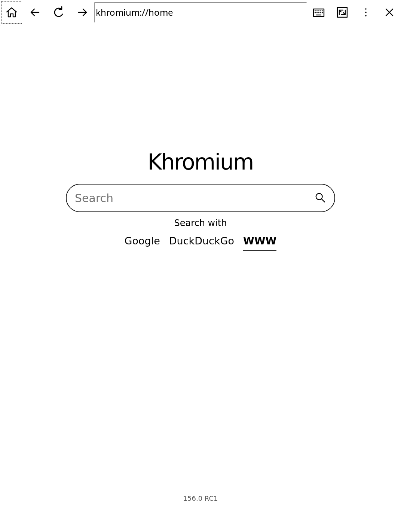

# Khromium — Alpha 0.0.1

An experimental Chromium-powered browser for the jailbroken **Kindle Paperwhite 4 on firmware 5.17.1**, with a touch-friendly GTK2 interface and an on-screen keyboard.

**Made with AI:** this project was developed with substantial AI assistance, including generated code and documentation. It is an independent experiment, unaffiliated with Amazon or the Chromium project. Please report bugs and review the code before relying on it.



## Download and install

1. Download `Khromium-Alpha-0.0.1-PW4.zip` from [Releases](https://github.com/gabo11dev/Khromium/releases).
2. You need an already jailbroken PW4 with KUAL installed. This package does not jailbreak or update your Kindle. Allow about **260 MB of free storage** plus space for website data.
3. Connect the Kindle over USB and extract the ZIP **into the USB drive root**, keeping its folders:
   ```text
   Kindle USB root/
     khromiumld.so
     extensions/
       khromium/
         bin/
         engine/
         runtime/
         assets/
         launch.sh
         ...
   ```
   Do not place everything inside an extra folder. The installed path must be `/mnt/us/extensions/khromium`.
4. Eject the Kindle safely. In KUAL, open **Khromium → Open Khromium**.
5. Use **×** to exit. If it becomes unresponsive, use **Stop Khromium** in KUAL. Installation diagnostics are saved under `extensions/khromium/state/check.log`; the run log is `state/run.log`.

Close any earlier Chromium experiment before opening Khromium. This version uses its own installation folder and profile. To uninstall, close it and remove `extensions/khromium` and `khromiumld.so`. Removing `state/profile` resets settings, favorites, history, cookies and other browsing data.

## Interface

- The toolbar provides Home, Back, Reload, Forward, address/search, Keyboard, More and Exit.
- The top clock/battery strip is the **Kindle system status bar**. The window requests it through the Kindle window manager's `PC:T` property; it does not draw an imitation. This new behavior still needs confirmation on physical hardware.
- The default home page works offline. Choose Google, DuckDuckGo or **WWW**. WWW opens your input directly as an address, adding `https://` when needed; it never sends the text to a search engine. Input containing spaces requires a search provider.
- Keyboard toggles the bottom keyboard even with no field selected. Tap a field to choose where typing goes. Shift changes letter case; symbols, Space, Backspace and Enter are available.
- Swipe vertically to scroll pages.
- More opens History, Favorites and Settings. Favorites stores pages and reopens them in the current browser view. There are no simultaneous tabs in this alpha.
- Favorites initially contains **Chromium Settings** (`chromium://settings`) and **Dino** (`chromium://dino`). The settings address opens Khromium's GTK2 settings dialog: the headless engine does not provide the full desktop Chrome settings page. Dino uses bundled upstream Chromium game code adapted for this frontend.
- Settings changes the homepage, default search provider and user agent (Android 11 or Debian 13), and can delete cookies. The user-agent option changes browser identification and client hints; it does not install another operating system.

## Limits and safety

This is an **alpha**, not a supported Chromium distribution. The previous GTK2 prototype worked on the owner's PW4; this release's new interface has been tested on a desktop with Chromium and with the ARM engine under emulation. Its final appearance, native status bar and dialog placement require a physical Kindle test.

The included launcher runs Chromium **without its sandbox**, because the target Kindle kernel lacks the required facilities. A malicious website exploiting Chromium could access files and permissions available to the browser. Avoid sensitive accounts and untrusted pages. HTTPS certificate validation remains enabled. There is no automatic security-update mechanism.

The device has about 512 MB RAM. Complex sites can exhaust memory. Pages are captured to the GTK2 view about once per second; video, animations and Dino are slow on e-ink. Downloads, audio/video playback, extensions, password management and desktop Chromium UI are not implemented. Engine processes and the keyboard can consume substantial battery.

## What is actually running?

- Chromium **headless-shell 156.0.8078.73 ARMhf**, from Raspberry Pi's Debian 12 packages, running locally on the Kindle.
- A small custom GTK2 C frontend using the Kindle's GTK2 and X11.
- A private Debian 12 ARMhf runtime (glibc 2.36), without replacing firmware libraries.
- The engine ELF interpreter path is changed to `/mnt/us/khromiumld.so`; the engine code is otherwise unchanged. This is a frontend/integration port, not a full Chromium source rebuild against GTK2.

The Kindle framework stays running so it can provide the system status bar. Window-manager behavior is documented by the community in [Awesome Window Manager](https://kindlemodding.org/kindle-dev/awesome-window-manager/).

## Build the frontend

Requires Python 3, pkg-config, and a Chromium checkout containing its Clang toolchain and Bullseye ARMhf sysroot (GTK2 headers/libraries). The release frontend used the Chromium 156.0.8078.79 checkout.

```sh
export CHROMIUM_SRC=/path/to/chromium/src
python3 frontend/build.py armhf
# Output: build/frontend-armhf/khromium
```

For a native Linux test build, install the GTK2 development package and run `python3 frontend/build.py amd64`. A native build requires a headless-shell engine and X11:

```sh
mkdir -p /tmp/khromium-profile
build/frontend-amd64/khromium --engine /absolute/path/chrome-headless-shell \
  --profile /tmp/khromium-profile --assets "$PWD/assets"
```

Only add `--unsafe-no-sandbox` when required by your test environment. The ARM release frontend must remain compatible with the Kindle's older GLib/GTK2; do not blindly build it against a newer system runtime.

## Assemble a release

The packager takes the original working GTK2 prototype ZIP (for its private runtime/licenses) and the **unmodified** ARM Chromium package directory (for the engine), then copies the new frontend and assets. It checks all engine/runtime shared-library dependencies and writes checksums.

```sh
python3 scripts/package.py --base /path/chromium-pw4-156-experimental.zip \
  --engine-dir /path/extracted/usr/lib/chromium \
  --output /path/Khromium-Alpha-0.0.1-PW4.zip
```

The release ZIP includes a source archive. This repository does not include binary engines or private browsing data. See [third-party notices](THIRD_PARTY_NOTICES.md) for component provenance and source locations. The standalone repository is not a replacement for the external ARM runtime input.

Dino's original TypeScript sources are in `third_party/dino`. To regenerate its bundled JavaScript, install TypeScript and run `node bundle-dino.js` with `TYPESCRIPT_PATH` pointing to TypeScript's `lib/typescript.js`.

## Validation

The integration harness checks real browser rendering, home-page defaults, direct-address behavior, keyboard toggling, Shift/Enter, Android client hints, settings/cookie requests, default favorites, Dino canvas startup and saved preferences. See [tests](tests/README.md). Screen captures in `docs/` come from desktop testing; they do not show the Kindle system bar.

## License

Khromium's original code is MIT licensed. Chromium/Dino, jsmn and redistributed runtime components retain their own licenses. See `LICENSE`, `frontend/vendor/jsmn.h`, `third_party/dino/LICENSE`, and the release's `licenses/` directory.
